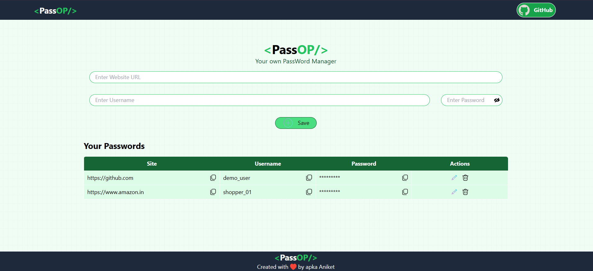

# 🔐 PassOP — Your Own Password Manager

PassOP is a full-stack password manager built with the **MERN-style stack** (React, Express, Node.js, MongoDB). Save the credentials for your websites, view them whenever you need, copy them with one click, and edit or delete them later.



## ✨ Features

- ➕ **Add** a website, username and password
- 📋 **Copy** the site, username, or password to the clipboard with one click
- 👁️ **Show / hide** the password while typing it
- ✏️ **Edit** any saved entry
- 🗑️ **Delete** an entry (with a confirmation prompt)
- 🔔 Toast notifications for every action
- 💾 Data stored persistently in **MongoDB**
- 📱 Responsive UI built with **Tailwind CSS**

## 🛠️ Tech Stack

| Layer    | Technologies                                                        |
| -------- | ------------------------------------------------------------------- |
| Frontend | React 19, Vite, Tailwind CSS, React-Toastify, uuid, Lordicon        |
| Backend  | Node.js, Express 5, MongoDB Node driver, CORS, body-parser, dotenv  |
| Database | MongoDB (database: `passop`, collection: `passwords`)               |

## 📁 Project Structure

```
PassOP/
├── Backend/
│   ├── server.js          # Express server + REST API
│   ├── package.json
│   └── .env               # Environment variables (not committed)
│
└── Client/
    ├── public/
    │   └── icons/         # Icons used in the UI
    ├── src/
    │   ├── components/
    │   │   ├── Navbar.jsx
    │   │   ├── Manager.jsx   # Main password manager logic + UI
    │   │   └── Footer.jsx
    │   ├── App.jsx
    │   └── main.jsx
    ├── index.html
    ├── tailwind.config.js
    ├── vite.config.js
    └── package.json
```

## ✅ Prerequisites

Make sure you have these installed:

- [Node.js](https://nodejs.org/) (v18 or higher recommended)
- [MongoDB](https://www.mongodb.com/try/download/community) running locally on the default port `27017` (or a MongoDB Atlas cluster)
- [Git](https://git-scm.com/)

## 🚀 Getting Started

### 1. Clone the repository

```bash
git clone https://github.com/<your-username>/<your-repo-name>.git
cd <your-repo-name>
```

### 2. Set up the Backend

```bash
cd Backend
npm install
```

Make sure MongoDB is running locally on port `27017`.

Start the server:

```bash
node server.js
```

The API will run at **http://localhost:3000**.

> **Note:** The backend currently connects to MongoDB using `mongodb://localhost:27017`. To use MongoDB Atlas or another database, update the MongoDB connection URL in `server.js` first.

### 3. Set up the Frontend

Open a **new terminal**:

```bash
cd Client
npm install
npm run dev
```

The app will run at **http://localhost:5173** (Vite's default). Open it in your browser and start saving passwords.

> Make sure MongoDB and the backend are both running before using the app.

## 📡 API Reference

Base URL: `http://localhost:3000`

| Method   | Endpoint | Description                  | Request Body                              |
| -------- | -------- | ---------------------------- | ----------------------------------------- |
| `GET`    | `/`      | Get all saved passwords      | —                                         |
| `POST`   | `/`      | Save a new password          | `{ id, site, username, password }`        |
| `PUT`    | `/`      | Update an existing password  | `{ id, site, username, password }`        |
| `DELETE` | `/`      | Delete a password            | `{ id }`                                  |

**Example document stored in MongoDB:**

```json
{
  "_id": "6540f1c2a1b2c3d4e5f67890",
  "id": "a3f1c9e2-7b4d-4e8a-9c1f-2d5e6f7a8b9c",
  "site": "https://github.com",
  "username": "myusername",
  "password": "mypassword"
}
```

## 🧪 Available Scripts (Client)

| Command           | Description                         |
| ----------------- | ----------------------------------- |
| `npm run dev`     | Start the development server        |
| `npm run build`   | Create a production build           |
| `npm run preview` | Preview the production build        |
| `npm run lint`    | Run ESLint                          |

## ⚠️ Security Notice

This is a **learning project**. Passwords are currently stored in the database as **plain text** and the API has **no authentication**. Please do **not** use it to store real, sensitive credentials in its current state.

## 🗺️ Future Improvements

- [ ] Encrypt stored passwords using a well-designed encryption and key-management approach
- [ ] User authentication (signup / login with JWT)
- [ ] Use environment variables for the API URL and MongoDB connection
- [ ] Search and filter saved passwords
- [ ] Deploy the app (Render / Vercel / MongoDB Atlas)

## 🤝 Contributing

Contributions, issues and feature requests are welcome!

1. Fork the project
2. Create your feature branch: `git checkout -b feature/my-feature`
3. Commit your changes: `git commit -m "Add my feature"`
4. Push to the branch: `git push origin feature/my-feature`
5. Open a Pull Request

## 👤 Author

**Aniket Kumar Gupta**

⭐ If you found this project useful, consider giving it a star!
